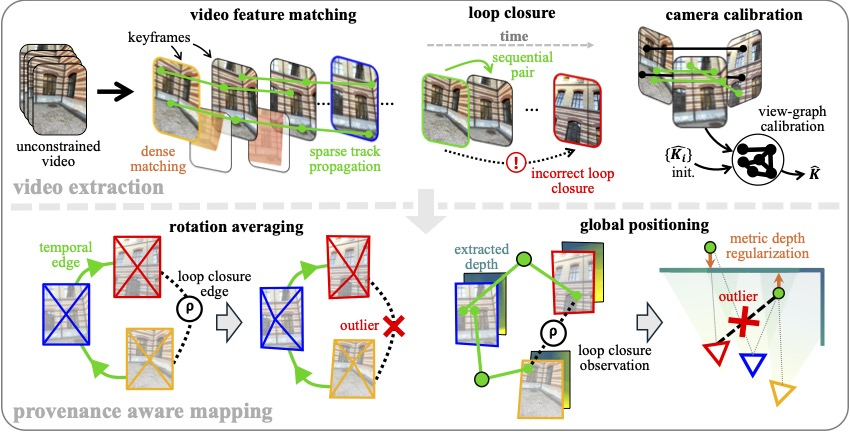

<h1 align="center">VidMap</h1>

<h3 align="center">Exploiting Temporal Structure for Video-Based Structure-from-Motion</h3>

<p align="center">
  <a href="https://www.linkedin.com/in/zador-pataki-a297b5196/">Zador&nbsp;Pataki</a>
  · <a href="https://psarlin.com/">Paul-Edouard&nbsp;Sarlin</a>
  · <a href="https://www.microsoft.com/en-us/research/people/mapoll/">Marc&nbsp;Pollefeys</a>
</p>

<p align="center"><strong>ECCV 2026</strong></p>

<p align="center">
  <a href="https://arxiv.org/abs/2607.27194">Paper</a> |
  <a href="https://youtu.be/gy4szd3q5Oo">Video</a> |
  <a href="https://github.com/Zador-Pataki/VidMap-assets/releases/download/eccv-2026/vidmap_eccv_poster.pdf">Poster</a> |
  <a href="https://github.com/Zador-Pataki/VidMap-assets/releases/download/eccv-2026/vidmap_slides.pdf">Slides</a>
</p>


<p align="center">
  
</p>

VidMap is an offline Structure-from-Motion system for video. It combines
temporal tracks, loop closures, metric depth, and global optimization to
estimate camera poses, camera intrinsics, and a sparse 3D map.

## Quick Start

- 🔧 [Setup](#setup) — Install dependencies and prepare the environment.
- 🚀 [Run VidMap](#execution) — Reconstruct a video or image sequence.
- 📷 [Camera rigs, panoramas, and fisheye](#camera-rigs-panoramas-and-fisheye) — Configure your cameras.
- 👀 [Visualization](#visualization) — Explore your reconstruction in the browser or Rerun.
- 🛠️ [Pipeline Configurations](#configuration) — Customize the frontend and mapping settings.
- ⚡ [Speed up VidMap](#speed-up-vidmap) — Find settings to make extraction and mapping faster.
- 📈 [Benchmarks](#benchmarks) — Prepare datasets and evaluate reconstruction accuracy.

## Setup

We provide the Python package [`vidmap`](vidmap). From a clean Python environment,
clone VidMap and its pinned model dependencies:

```bash
git clone --recursive https://github.com/cvg/vidmap.git && cd vidmap
```

Build and install [COLMAP](https://github.com/colmap/colmap) and its PyCOLMAP bindings
[from source](https://colmap.github.io/install.html#build-from-source).
Last tested with: [COLMAP `b1972bc2`](https://github.com/colmap/colmap/commit/b1972bc226f58e095c8b75bc214f4bb2d8ba57e4).
For GPU mapper acceleration, build them against
[Ceres 2.3 or newer](https://ceres-solver.readthedocs.io/latest/installation.html)
with CUDA and cuDSS instead ([see how to enable](#gpu-acceleration)).

Then install [PyTorch](https://docs.pytorch.org/get-started/locally/),
[xFormers](https://github.com/facebookresearch/xformers), and VidMap:

```bash
pip install -e .
```

The frontend was last tested on Linux x86-64 with Python 3.10, PyTorch 2.14.0,
TorchVision 0.29.0 and xFormers 0.0.35 on NVIDIA GPUs.
Fast loading of cached compiled models requires PyTorch 2.10+.

The first frontend run automatically downloads approximately 9 GB of model
checkpoints and caches approximately 1.2 GB of compiled models.

**Optional visualization setup.** Install [Rerun](https://rerun.io/):

```bash
pip install rerun-sdk
```

## Execution

The repository includes a silent example video. Run the frontend to build its mapper inputs, then
run mapping:

```bash
INPUT_DATA=./assets/example_video.mp4
OUTPUT_DIR=./example_output/
MAPPER_INPUTS="$OUTPUT_DIR/mapper_inputs"

python -m vidmap.frontend "$INPUT_DATA" \
  --output "$OUTPUT_DIR"

python -m vidmap.map \
  --mapper-inputs "$MAPPER_INPUTS" \
  --output "$OUTPUT_DIR"
```

Alternatively, run frontend and mapping together:

```bash
python -m vidmap.run \
  --input_data "$INPUT_DATA" \
  --output "$OUTPUT_DIR"
```

Alternatively, `--input_data` may point to a directory of extracted frames.

Both mapping commands write the final COLMAP model under `$OUTPUT_DIR/rec`.
Resolved `frontend_config.yaml` and `mapping_config.yaml` are written directly
under `$OUTPUT_DIR`.

See [files and folders](docs/files.md) for image layouts, frame associations,
configuration files and run artifacts.

### Camera rigs, panoramas, and fisheye

| Input | Uncalibrated mono | Calibrated mono | Uncalibrated rig | Calibrated rig |
|---|:---:|:---:|:---:|:---:|
| Pinhole | [✓](docs/cameras.md#monocular) | [✓](docs/cameras.md#calibrated-monocular) | ✗ | [✓](docs/cameras.md#camera-rigs) |
| Distorted perspective | [✓](docs/cameras.md#distorted-monocular) | [✓](docs/cameras.md#calibrated-monocular)² | ✗ | [✓](docs/cameras.md#camera-rigs)² |
| Fisheye | [✓](docs/cameras.md#camera-setup)¹ | [✓](docs/cameras.md#calibrated-monocular)² | ✗ | [✓](docs/cameras.md#camera-rigs)² |
| Stitched 360° panorama | N/A | [✓](docs/cameras.md#panoramas) | N/A | ✗ |

Distorted perspective models: `SIMPLE_RADIAL`, `RADIAL`, `OPENCV`, `FULL_OPENCV`,
`SIMPLE_DIVISION`, `DIVISION`. See [COLMAP camera models](https://colmap.github.io/cameras.html)
for model definitions and parameter order.

1. Native `OPENCV_FISHEYE`, forward-facing rays only.
2. Undistorted to pinhole before mapping. Calibrated rigs may mix camera models.

## Visualization

### Browser viewer

Open the [vidmap-viewer](vidmap/visualization/vidmap-viewer.html) in a
Chromium-based browser and choose a run folder containing `rec/` and
`mapper_inputs/`. The viewer requires internet access.

<details>
<summary>[Embed a reconstruction - click to expand]</summary>

```bash
python -m vidmap.visualization.html --run-dir "$OUTPUT_DIR"
```

This embeds the reconstruction in `$OUTPUT_DIR/vidmap-viewer-embedded.html`, so
it opens without selecting a run folder.

</details>

<p align="center">
  
</p>

### Rerun playback

To render optimization playback, record solver states during mapping:

```bash
python -m vidmap.map \
  --mapper-inputs "$MAPPER_INPUTS" \
  --output "$OUTPUT_DIR" \
  --save-playback-trace
```

This writes the trace to `$OUTPUT_DIR/playback_trace/`.

Create solver-playback and flythrough recordings. Local images, frame timing,
and missing ground truth are detected automatically:

```bash
VISUALS=./example_visuals/

python -m vidmap.visualization.rerun.playback "$OUTPUT_DIR" \
  --view isometric \
  --output "$VISUALS/solver-playback.rrd"

python -m vidmap.visualization.rerun.flythrough "$OUTPUT_DIR" \
  --reconstruction final \
  --view follow \
  --output "$VISUALS/flythrough.rrd"
```

<details>
<summary>[Flythroughs with lifted depth maps - click to expand]</summary>

Depth lift replaces the current sparse highlight with the RGB-colored full
depth prediction. Retain those predictions during reconstruction with
`--cache-depth-maps`, then create an RRD:

```bash
python -m vidmap.visualization.rerun.flythrough "$OUTPUT_DIR" \
  --depth-lift \
  --output "$VISUALS/depth-flythrough.rrd"
```

If the first frontend run did not cache full depth maps, backfill them without
repeating tracking or verification:

```bash
python -m vidmap.frontend "$INPUT_DATA" \
  --output "$OUTPUT_DIR" \
  --mapper-inputs "$OUTPUT_DIR/mapper_inputs" \
  --cache-depth-maps
```

</details>

Open the recordings with Rerun:

```bash
rerun "$VISUALS/solver-playback.rrd"
rerun "$VISUALS/flythrough.rrd"
```

<p align="center">
  
</p>

Don't forget to try VidMap on your favorite videos from the web.

<p align="center">
  
</p>

## Configuration

<p align="center">
  
  <br>
  <em>VidMap extends COLMAP's global mapping pipeline, for which we provide easily adjustable hyperparameters via configs.</em>
</p>

VidMap uses [Hydra](https://hydra.cc/) and
[OmegaConf](https://omegaconf.readthedocs.io/) for fine-grained configuration
with typed defaults. [Frontend configs](vidmap/configs/frontend) control tracks,
keyframes, depth, and calibration, while [mapping configs](vidmap/configs/mapping)
control global positioning and bundle adjustment. Frontend settings follow
the pipeline itself: keyframe matching, selection, and features are grouped
together; track matching and propagation form a separate stage.

Print all available frontend and mapping defaults:

```python
from vidmap.configuration import FrontendConfig, MappingConfig, summarize_cfg

print(summarize_cfg(FrontendConfig()))
print(summarize_cfg(MappingConfig()))
```

<details>
<summary>[Custom configuration - click to expand]</summary>

Each YAML file overrides only the relevant defaults and can inherit another
configuration with `defaults:`.

For example, define a compatible frontend and mapping pair:

```yaml
# vidmap/configs/frontend/uncalib/custom.yaml
defaults:
  - base

keyframes:
  selection:
    max_normalized_keypoint_drift: 0.09
```

```yaml
# vidmap/configs/mapping/uncalib/custom.yaml
defaults:
  - base

mapper:
  gp:
    first_pass:
      loss_lc_geometry:
        weight: 0.3
```

Select custom configs and adjust either stage inline with Hydra overrides:

```bash
python -m vidmap.run \
  --input_data "$INPUT_DATA" \
  --output "$OUTPUT_DIR" \
  --frontend-conf uncalib/custom \
  --mapping-conf uncalib/custom \
  frontend.keyframes.selection.max_normalized_keypoint_drift=0.08 \
  mapping.mapper.gp.first_pass.loss_lc_geometry.weight=0.4
```

</details>

<a id="gpu-acceleration"></a>
<details>
<summary>[GPU acceleration - click to expand]</summary>

Enable GPU acceleration for global positioning and bundle adjustment (requires
Ceres 2.3 or newer with GPU support; see [Setup](#setup)):

```bash
python -m vidmap.run \
  --input_data "$INPUT_DATA" \
  --output "$OUTPUT_DIR" \
  mapping.mapper.gp.solver_backend.use_cuda=true \
  mapping.mapper.ba.solver_backend.use_cuda=true
```

</details>

### Recommended configurations

- [`default`](vidmap/configs/mapping/uncalib/base.yaml): The default reconstruction
  pipeline, based on the method described in the paper.
- [`smooth_trajectory`](vidmap/configs/mapping/uncalib/smooth_trajectory.yaml):
  Experimental pipeline. Adds keyframe-coordinate trajectory smoothing to the
  default pipeline for improved robustness on long sequences, as explored on
  external datasets.

### Speed up VidMap

Reducing the number of tracked points, using coarse-only keyframing, and using
fewer propagation hops can speed up VidMap. Running global positioning on
[CUDA](#gpu-acceleration) reduced total mapping time by about **13%** on a tested
LaMAR HGE sequence. The benefit of GPU acceleration for bundle adjustment is
less clear.

```bash
python -m vidmap.run \
  --input_data "$INPUT_DATA" \
  --output "$OUTPUT_DIR" \
  frontend.tracks.propagation.max_kps=1000 \
  frontend.keyframes.matching.coarse_only=true \
  'frontend.tracks.propagation.multiflow_hops=[1,2,4,8]' \
  mapping.mapper.gp.solver_backend.use_cuda=true \
  mapping.mapper.ba.solver_backend.use_cuda=true
```

The table below provides insight into the accuracy–runtime tradeoffs.
Extraction savings approximately exclude startup by subtracting the recorded first calls.

| Setting | Stage measured | Time saved | Mean accuracy drop |
| --- | --- | ---: | ---: |
| Hops `[1,2,4,8]` | Extraction | ~9.9% | ~0% |
| Hops `[1,2,4]` | Extraction | ~15.3% | 0.385% |
| Hops `[1,2]` | Extraction | ~21.3% | 1.563% |
| Coarse keyframing | Extraction | ~9.0% | 0.053% |
| 1,000 points, balanced | Mapping | ~40% | 0.632% |
| 500 points, balanced | Mapping | ~66% | 2.067% |

## Benchmarks

### Prepare data

By default, prepared data, caches, and experiments live under
`./local/{datasets,cache,experiments}/<dataset>/`, relative to the directory
where the command is run. To use other paths, create `./vidmap-paths.toml` or
set `VIDMAP_<DATASET>_{DATA,CACHE,EXP,TESTSETS}_DIR`.

Spires and Hilti require the ROS bag reader (`pip install -e '.[dataset-preparation]'`).

Then select and prepare a benchmark dataset:

```bash
DATASET=lamar  # or: euroc, eth3d_slam, crocodl, spires, hilti
python -m vidmap.datasets.prepare --dataset "$DATASET"
```

This downloads and validates the supported evaluation inventory, then converts
it into the dataset layouts below. LaMAR intentionally
prepares only the images referenced by its benchmark testset: sessions and
images absent from that testset are not retained. Downloads resume after
interruption and completed sequences are reused. Validated source archives are
retained by default; pass `--delete-downloads` to remove them after successful
preparation. EuRoC and ETH3D-SLAM prepare only cam0 by default; `--mode stereo`
or `--mode all` prepares both cameras, reusing existing cam0 images in the same
folder. For Spires and Hilti, add `--workers N` to prepare N recordings concurrently.

<details>
<summary>[Expected prepared dataset layouts - click to expand]</summary>

Storage for the supported evaluation inventories:

| Dataset | Download | Prepared |
| --- | ---: | ---: |
| LaMAR (sample-300) | 45.2 GB | 24.0 GB |
| LaMAR (complete) | 144.5 GB | 76.7 GB |
| EuRoC (monocular) | 24.7 GB | 4.7 GB |
| EuRoC (rig) | 24.7 GB | 9.6 GB |
| ETH3D-SLAM (monocular) | 18.6 GB | 18.6 GB |
| ETH3D-SLAM (rig) | 37.3 GB | 37.3 GB |
| CroCoDL | 15.0 GB | 14.0 GB |
| Oxford Spires (rectified monocular, default) | 89.7 GB | 29.3 GB |
| Oxford Spires (fisheye monocular) | 89.7 GB | 15.8 GB |
| Oxford Spires (rectified rig) | 89.7 GB | 89.8 GB |
| Hilti 360° | 132.1 GB | 120 GB |

Download sizes are the checksum-pinned source archives; prepared sizes cover
the canonical dataset after conversion. LaMAR archives are session-level, so
the download includes unused frames inside each required session ZIP; only the
selected testset images are retained. Retaining downloads requires roughly the sum
of both columns, plus conversion staging. Hilti's prepared size is estimated from
120 panoramas sampled across all 30 recordings.

After preparation, the selected dataset is available under
`./local/datasets/<dataset>/`, with its benchmark definitions under
`./local/testsets/<dataset>/`:

```text
local/
├── datasets/<dataset>/<scene>/<recording>/
│   ├── preparation.json
│   └── <variant>/
│       ├── images/cam0/...         # cam1/, cam2/, ... when available
│       └── rec/                   # Matching calibration and reference poses
└── testsets/<dataset>/<scene>/<mode>.yaml
```

| Dataset | Variant(s) |
| --- | --- |
| LaMAR, ETH3D-SLAM, CroCoDL | `native` |
| EuRoC | `rectified` |
| Oxford Spires | `native`, `rectified` |
| Hilti 360° | `panorama` |

<details>
<summary>[Examples for each dataset - click to expand]</summary>

```text
local/datasets/
├── lamar/CAB/ios_2021-06-02_14.21.49_000/
│   ├── preparation.json
│   └── native/
│       ├── images/cam0/...
│       └── rec/
├── euroc/machine_hall/MH_01_easy/
│   ├── preparation.json
│   └── rectified/
│       ├── images/cam0/...         # cam1/ when stereo is prepared
│       └── rec/
├── eth3d_slam/plant_1/0/
│   ├── preparation.json
│   └── native/
│       ├── images/cam0/...         # cam1/ when stereo is prepared
│       └── rec/
├── crocodl/ios-ARCHE_D2/ios_2023-07-12_20.46.14_000/
│   ├── preparation.json
│   └── native/
│       ├── images/cam0/...
│       └── rec/
├── spires/2024-03-12-keble-college-02/0/
│   ├── preparation.json
│   ├── native/
│   │   ├── images/cam0/...
│   │   └── rec/
│   └── rectified/
│       ├── images/
│       │   ├── cam0/...
│       │   ├── cam1/...
│       │   └── cam2/...
│       └── rec/
└── hilti/floor_1_2025-05-05_run_1/0/
    ├── preparation.json
    └── panorama/
        ├── images/cam0/...
        └── rec/

local/testsets/
├── lamar/CAB/sample.yaml
├── euroc/machine_hall/mono.yaml
├── eth3d_slam/plant_1/mono.yaml
├── crocodl/ios-ARCHE_D2/complete.yaml  # Also sample-*.yaml
├── spires/2024-03-12-keble-college-02/
│   ├── undistorted-mono.yaml
│   ├── fisheye-mono.yaml
│   └── undistorted-rig.yaml
└── hilti/floor_1_2025-05-05_run_1/panorama.yaml
```

</details>

Each `rec/` contains calibration and camera poses, without 3D points.
Select a benchmark with `--mode`; its testset specifies the recording, image variant and image IDs.

</details>

### Run and evaluate

```bash
FRONTEND_CONF=uncalib/base
MAPPING_CONF=uncalib/base
# Omit --name below to derive the output name from the config pair.
OUTPUT_NAME=default

python -m vidmap.run_for_benchmark \
  --dataset "$DATASET" \
  --frontend-conf "$FRONTEND_CONF" \
  --mapping-conf "$MAPPING_CONF" \
  --name "$OUTPUT_NAME"
```

Inline Hydra overrides use the same `frontend.<field>=<value>` and
`mapping.<field>=<value>` prefixes as `vidmap.run`.

The command reconstructs and evaluates every selected target, then prints the
final aggregate report across all completed trajectories. Add `--run-only` to
skip only this final report; per-trajectory evaluation still runs.

<details>
<summary>[LaMAR - click to expand]</summary>

LaMAR defaults to `complete` with `wate_auc` evaluation.

```bash
python -m vidmap.run_for_benchmark \
  --dataset lamar \
  --frontend-conf uncalib/gtkf-base \
  --mapping-conf uncalib/base
```

For the trajectories used in the paper, prepare `sample-300` and run `sample`:

```bash
python -m vidmap.datasets.prepare -d lamar --profile sample-300

python -m vidmap.run_for_benchmark \
  --dataset lamar --mode sample \
  --frontend-conf uncalib/gtkf-base \
  --mapping-conf uncalib/base
```

Use separate dataset/testset roots to keep both profiles.

</details>

<details>
<summary>[EuRoC - click to expand]</summary>

EuRoC defaults to `mono` with `pose_auc` evaluation.

```bash
python -m vidmap.run_for_benchmark \
  --dataset euroc \
  --frontend-conf uncalib/base \
  --mapping-conf uncalib/base
```

For calibrated stereo:

```bash
python -m vidmap.run_for_benchmark \
  --dataset euroc --mode stereo \
  --frontend-conf calib/stereo \
  --mapping-conf calib/base
```

</details>

<details>
<summary>[ETH3D-SLAM - click to expand]</summary>

ETH3D-SLAM defaults to `mono` with `pose_auc` evaluation.

```bash
python -m vidmap.run_for_benchmark \
  --dataset eth3d_slam \
  --frontend-conf uncalib/base \
  --mapping-conf uncalib/base
```

For calibrated stereo:

```bash
python -m vidmap.run_for_benchmark \
  --dataset eth3d_slam --mode stereo \
  --frontend-conf calib/stereo \
  --mapping-conf calib/base
```

</details>

<details>
<summary>[CroCoDL - click to expand]</summary>

Evaluate the complete CroCoDL benchmark. CroCoDL selects `wate_auc` by default.

```bash
python -m vidmap.run_for_benchmark \
  --dataset crocodl \
  --frontend-conf uncalib/base \
  --mapping-conf uncalib/base
```

</details>

<details>
<summary>[Oxford Spires - click to expand]</summary>

Oxford Spires has 13 scenes and defaults to rectified monocular images
(`undistorted-mono`). Select a mode with `--mode`.

| Mode | Frontend config | Mapping config |
| --- | --- | --- |
| `undistorted-mono` (default) | `uncalib/base` | `uncalib/base` |
| `undistorted-mono` | `calib/base` | `calib/base` |
| `fisheye-mono` | `uncalib/fisheye` | `uncalib/geocalib` |
| `undistorted-rig` | `calib/rig` | `calib/base` |

```bash
python -m vidmap.datasets.prepare --dataset spires --mode undistorted-rig

python -m vidmap.run_for_benchmark \
  --dataset spires --mode undistorted-rig \
  --frontend-conf calib/rig --mapping-conf calib/base
```

Evaluation uses scale-aligned WATE-AUC on cam0.

</details>

<details>
<summary>[Hilti 360° - click to expand]</summary>

Hilti has 30 sequences and defaults to `panorama` mode. Select perspective views
with [`rig.projection`](docs/cameras.md#panoramas).

```bash
python -m vidmap.run_for_benchmark \
  --dataset hilti \
  --frontend-conf calib/panorama --mapping-conf calib/base
```

Evaluation uses scale-aligned WATE-AUC on view 0.

</details>

<details>
<summary>[Results - click to expand]</summary>

WATE-AUC with late principal point refinement, at 5% error thresholds (%, higher
is better). Results are averaged equally across eligible sequences. ATE is the mean
per-sequence translation RMSE after global Sim(3) alignment (meters, lower is
better), evaluated at GT-supported estimated poses:

| Dataset | ATE (m) ↓ | 10 m @ 0.5 m | 25 m @ 1.25 m | 50 m @ 2.5 m | 100 m @ 5 m | Full @ 5% |
| :--- | ---: | ---: | ---: | ---: | ---: | ---: |
| LaMAR (sample-300, 50 sequences) | 0.878 | 92.43 | 93.08 | 91.79 | 91.03 | 90.41 |
| CroCoDL (64 sequences) | 0.233 | 95.72 | 97.27 | 97.39 | 96.56 | 98.21 |
| LaMAR (complete, 53 evaluated sequences) | 1.452 | 92.42 | 92.83 | 92.38 | 92.59 | 89.76 |
| Oxford Spires (rectified monocular, 10 sequences) | 0.130 | 98.98 | 99.10 | 99.11 | 99.10 | 99.54 |
| Oxford Spires (three-camera rig, 13 sequences) | Pending | Pending | Pending | Pending | Pending | Pending |
| Hilti (three-view, 30 sequences) | Pending | Pending | Pending | Pending | Pending | Pending |

Pose AUC, averaged equally across sequences (%, higher is better):

| Dataset | ATE (m) ↓ | 5 cm | 10 cm | 50 cm | 1 m | 10 m |
| :--- | ---: | ---: | ---: | ---: | ---: | ---: |
| EuRoC (11 sequences) | 0.044 | 28.44 | 59.74 | 91.91 | 95.95 | 99.60 |
| ETH3D-SLAM (55 sequences) | 0.268 | 80.32 | 87.85 | 95.86 | 97.35 | 99.28 |

</details>

<details>
<summary>[Optionally re-evaluate saved results - click to expand]</summary>

Recompute evaluation reports without rerunning reconstruction:

```bash
python -m vidmap.evaluate_results \
  --dataset "$DATASET" \
  --name "$OUTPUT_NAME"
```

</details>

## BibTeX citation

If you use any ideas from the paper or code from this repository, please
consider citing:

```bibtex
@inproceedings{pataki2026vidmap,
  author    = {Zador Pataki and
               Paul-Edouard Sarlin and
               Marc Pollefeys},
  title     = {{VidMap: Exploiting Temporal Structure for Video-Based Structure-from-Motion}},
  booktitle = {ECCV},
  year      = {2026}
}
```

## Acknowledgments

VidMap builds on [COLMAP](https://github.com/colmap/colmap),
[MP-SfM](https://github.com/cvg/mpsfm), and
[hloc](https://github.com/cvg/Hierarchical-Localization). For the video visualizations, dense matches were densely triangulated using 
[ImLoc](https://arxiv.org/abs/2601.04185).
