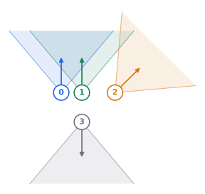

# Camera setup

Set your input/output paths and choose the config names below (without `.yaml`):

```bash
python -m vidmap.run --input_data /data/images --output /results/run \
  --frontend-conf FRONTEND_CONFIG --mapping-conf MAPPING_CONFIG
```

| Input | `FRONTEND_CONFIG` | `MAPPING_CONFIG` |
|---|---|---|
| Uncalibrated monocular | `uncalib/base` | `uncalib/base` |
| Uncalibrated distorted perspective | Saved config name | `uncalib/geocalib` |
| Uncalibrated monocular fisheye | `uncalib/fisheye` | `uncalib/geocalib` |
| Calibrated examples below | Saved config name | `calib/base` |

## Monocular

Put images in `/data/images/cam0/` and pass `/data/images` as the input root.
The default configuration uses uncalibrated monocular input.

### Distorted monocular

Save `vidmap/configs/frontend/my_distorted.yaml`, choosing a model from the [supported inputs](../README.md#camera-rigs-panoramas-and-fisheye):

```yaml
defaults: [uncalib/geocalib]
camera_priors:
  camera_model: OPENCV
```

Use `uncalib/geocalib` to initialize focal length and distortion before keyframing.
View-graph calibration then refines these estimates before they define the crop
used for depth prediction.

### Calibrated monocular

Use a one-camera rig. Save `vidmap/configs/frontend/my_camera.yaml`:

```yaml
defaults: [calib/base]
rig:
  cameras:
    - camera_model_name: PINHOLE
      camera_params: [500, 500, 420, 420]
```

Replace the calibration with yours. Put timestamp-named images (e.g. `1.000.png`)
in `/data/images/cam0/`.

## Camera rigs

Example four-camera rig: a stereo pair (0–1), an oblique camera (2), and a rear camera (3).



Use synchronized images in `cam0/` through `cam3/`;
see [input folders and frame association](files.md#input-images). Save `vidmap/configs/frontend/my_rig.yaml`:

```yaml
defaults: [calib/rig]
rig:
  cameras:
    - camera_model_name: PINHOLE
      camera_params: [500, 500, 420, 420]  # fx, fy, cx, cy (pixels)
    - camera_model_name: PINHOLE
      camera_params: [500, 500, 420, 420]
      cam_from_rig_rotation: [1, 0, 0, 0]
      cam_from_rig_translation: [-0.1, 0, 0]
    - camera_model_name: PINHOLE
      camera_params: [500, 500, 420, 420]
      cam_from_rig_rotation: [0.9238795325112867, 0, -0.3826834323650898, 0]
      cam_from_rig_translation: [-0.1414214, 0, -0.1414214]
    - camera_model_name: PINHOLE
      camera_params: [500, 500, 420, 420]
      cam_from_rig_rotation: [0, 0, 1, 0]
      cam_from_rig_translation: [0.1, 0, -0.15]
  match_same_timestamp: [[0, 1], [1, 2]]
  flag_same_timestamp_as_sequential: [[0, 1]]
```

Camera 0 is the reference and the default keyframing camera.

In this example:

- **0–1:** Reliable stereo overlap: included in `match_same_timestamp` and `flag_same_timestamp_as_sequential` for sequential losses.
- **1–2:** Overlap with a larger viewpoint change: included only in `match_same_timestamp`, using loop-closure losses.
- **3:** No overlap: omitted from `match_same_timestamp`.

## Panoramas

Put your 360° equirectangular images in `/data/images/cam0/`.
Save `vidmap/configs/frontend/my_panorama.yaml`:

```yaml
defaults: [calib/rig]
rig:
  projection:
    image_size: [840, 840]  # width, height
    horizontal_fov_degrees: 120.0
    views:
      0: {yaw_degrees: 0.0, pitch_degrees: 0.0}
      1: {yaw_degrees: 120.0, pitch_degrees: 0.0}
      2: {yaw_degrees: 240.0, pitch_degrees: 0.0}
```

**Full cube:** keep square images and replace the FOV and views inside `projection`:

```yaml
horizontal_fov_degrees: 90.0
views:
  0: {yaw_degrees: 0.0, pitch_degrees: 0.0}
  1: {yaw_degrees: 90.0, pitch_degrees: 0.0}
  2: {yaw_degrees: 180.0, pitch_degrees: 0.0}
  3: {yaw_degrees: 270.0, pitch_degrees: 0.0}
  4: {yaw_degrees: 0.0, pitch_degrees: 90.0}
  5: {yaw_degrees: 0.0, pitch_degrees: -90.0}
```

View 0 is the reference camera. Positive yaw turns right; positive pitch points up. Horizontal FOV must stay below 180°.

See [files and folders](files.md) for input naming, explicit frame associations and outputs.
